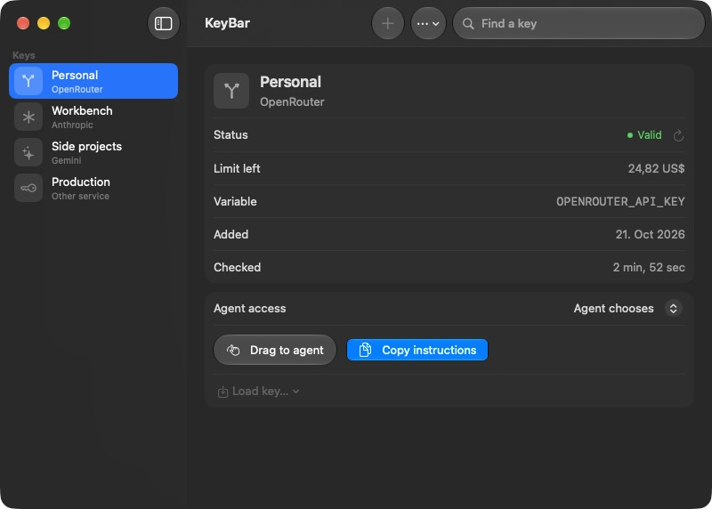
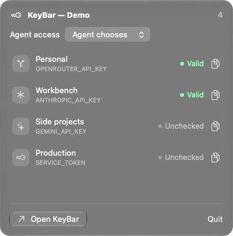

# KeyBar

A macOS menu-bar app for API keys. Store them in Keychain, check whether they work, and drag usage instructions into an agent chat.

Supports any API key. Built-in checks for Gemini, OpenRouter, Anthropic, and OpenAI. Shows when you added a key; OpenRouter also reports its remaining key limit when available.





## Install

Download the Apple silicon DMG from [Releases](https://github.com/PraneelBhatia/KeyBar/releases), open it, and drag KeyBar to Applications. Requires macOS 14 or later. If the menu-bar item is hidden, use **View → Show KeyBar in Menu Bar**. The current download is not Apple-notarized, so macOS may block opening it.

## Use

1. Add a key and its environment variable name.
2. Check access, or save without checking.
3. Drag a key into an agent chat, or copy its instructions. Choose Keychain, `.env`, `.zshrc`, or let the agent choose.

The note contains commands, never the key. **Load key…** writes a selected key into a project’s `.env` or adds a Keychain reference to `.zshrc` for new shells. `.env` is plain text; KeyBar adds it to `.gitignore` and refuses files already tracked by Git.

Keys are stored in local Keychain storage until explicitly exported. No analytics or sync. An agent given access can still read the key; use agents you trust. Checks confirm endpoint access, not billing or every model permission.

## Build

Requires Swift 6. No external dependencies.

```sh
./scripts/test.sh
./scripts/build-app.sh
open dist/KeyBar.app
```

Run `./scripts/build-dmg.sh` to package a DMG for your Mac's architecture.

[Usage and security details](docs/USAGE.md) · [Contributing](CONTRIBUTING.md) · [MIT license](LICENSE)
